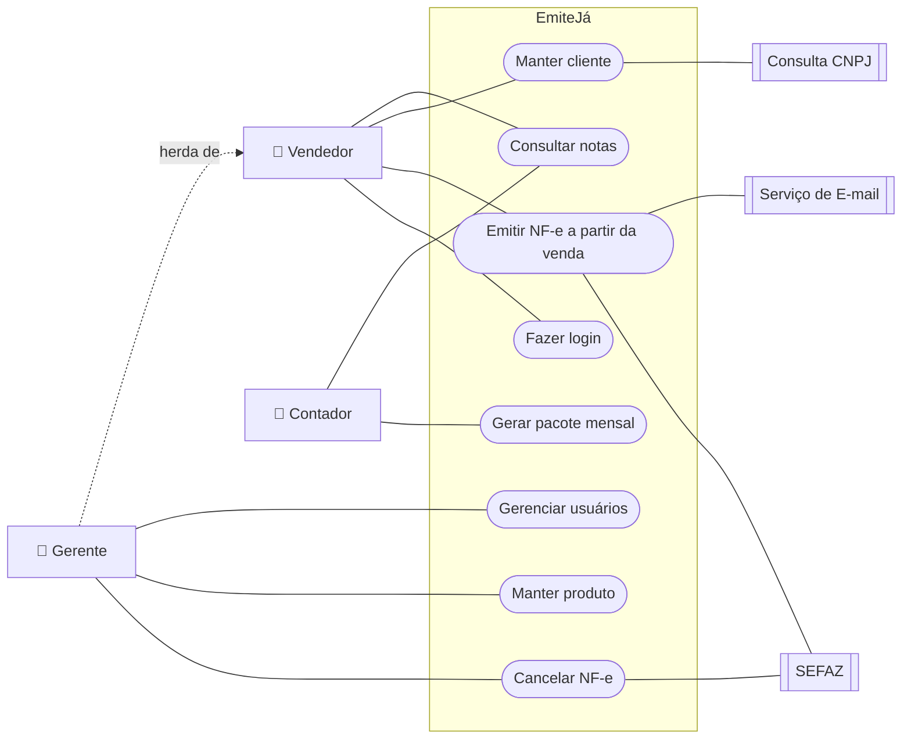

# Casos de Uso: EmiteJá

> Responsável: Kayk Thierry Araujo Silva (issue #3)

## 1. Diagrama de Casos de Uso

> O Gerente herda todos os casos de uso do Vendedor. Login é pré-condição de todos os casos de uso.

## 2. Especificação Expandida

### UC01: Emitir NF-e a partir da venda

- **Atores:** Vendedor (principal), SEFAZ, Serviço de E-mail.
- **Objetivo:** Transformar uma venda registrada em NF-e autorizada e entregá-la ao cliente.
- **Pré-condições:** Vendedor logado; certificado A1 válido; cliente e produtos cadastrados.
- **Pós-condições:** Nota autorizada, XML armazenado, DANFE enviado ao cliente.
- **Fluxo Principal:**
    1. O Vendedor registra a venda (cliente, produtos, quantidades, pagamento).
    2. O Vendedor seleciona "Gerar nota".
    3. O sistema monta a nota com os dados da venda e dos cadastros.
    4. O sistema valida os campos obrigatórios (RF07).
    5. O sistema assina e envia a nota à SEFAZ.
    6. A SEFAZ retorna a autorização.
    7. O sistema armazena o XML, gera o DANFE e envia ambos ao e-mail do cliente.
    8. O sistema exibe a nota com situação "Autorizada".
- **Fluxos Alternativos:**
    - **A1, passo 4, dados inválidos:** o sistema lista os erros (ex.: produto sem NCM) e leva o Vendedor ao cadastro correspondente; após correção, retorna ao passo 3.
    - **A2, passo 7, cliente sem e-mail:** o sistema oferece impressão do DANFE.
- **Exceções:**
    - **E1, passo 6, rejeição:** o sistema exibe código e motivo da rejeição, mantém a nota como "Rejeitada" e permite corrigir e reenviar.
    - **E2, passo 5, SEFAZ sem resposta:** o sistema mantém a nota como "Pendente" e tenta reenviar automaticamente a cada 2 minutos, avisando o Vendedor.

### UC02: Manter cliente

- **Atores:** Vendedor (principal), Consulta CNPJ.
- **Objetivo:** Cadastrar ou atualizar os dados de um cliente para uso nas vendas.
- **Pré-condições:** Usuário logado.
- **Pós-condições:** Cliente salvo e disponível na busca de vendas.
- **Fluxo Principal:**
    1. O Vendedor escolhe "Novo cliente" e informa o CPF ou CNPJ.
    2. O sistema verifica os dígitos verificadores (RN06).
    3. Sendo CNPJ, o sistema consulta o serviço público e preenche razão social e endereço.
    4. O Vendedor completa telefone e e-mail e confirma.
    5. O sistema salva o cliente.
- **Fluxos Alternativos:**
    - **A1, passo 1, documento já cadastrado:** o sistema abre o cadastro existente para edição.
    - **A2, passo 3, serviço indisponível:** o Vendedor preenche os dados manualmente.
- **Exceções:**
    - **E1, passo 2, documento inválido:** o sistema informa o erro e não prossegue.

### UC03: Cancelar NF-e

- **Atores:** Gerente (principal), SEFAZ.
- **Objetivo:** Cancelar uma nota autorizada emitida por engano.
- **Pré-condições:** Gerente logado; nota com situação "Autorizada".
- **Pós-condições:** Nota com situação "Cancelada" e evento de cancelamento armazenado.
- **Fluxo Principal:**
    1. O Gerente localiza a nota na consulta (UC06).
    2. O Gerente seleciona "Cancelar" e informa a justificativa.
    3. O sistema verifica o prazo (RN03) e o tamanho da justificativa (RN04).
    4. O sistema envia o evento de cancelamento à SEFAZ.
    5. A SEFAZ homologa o cancelamento.
    6. O sistema atualiza a situação da nota e avisa o cliente por e-mail.
- **Exceções:**
    - **E1, passo 3, prazo expirado:** o sistema bloqueia o cancelamento e orienta procurar o contador.
    - **E2, passo 5, recusa da SEFAZ:** o sistema exibe o motivo e mantém a nota "Autorizada".

### UC04: Gerar pacote mensal

- **Atores:** Contador (principal).
- **Objetivo:** Obter todos os documentos fiscais de um mês para a escrituração.
- **Pré-condições:** Contador logado; mês selecionado já encerrado.
- **Pós-condições:** Pacote .zip disponível para download e registrado no histórico.
- **Fluxo Principal:**
    1. O Contador acessa "Fechamento mensal" e escolhe o mês.
    2. O sistema reúne as notas autorizadas e canceladas do mês (RN07).
    3. O sistema gera um resumo em PDF com quantidade de notas, valor total e total de cancelamentos.
    4. O sistema compacta XMLs e resumo em um arquivo .zip.
    5. O Contador faz o download.
- **Fluxos Alternativos:**
    - **A1, passo 2, notas pendentes ou rejeitadas no mês:** o sistema lista essas notas e avisa o Gerente antes de gerar o pacote.
- **Exceções:**
    - **E1, passo 2, nenhum documento no mês:** o sistema informa que não há notas e não gera o pacote.
