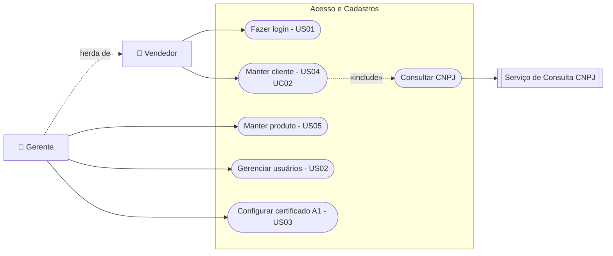
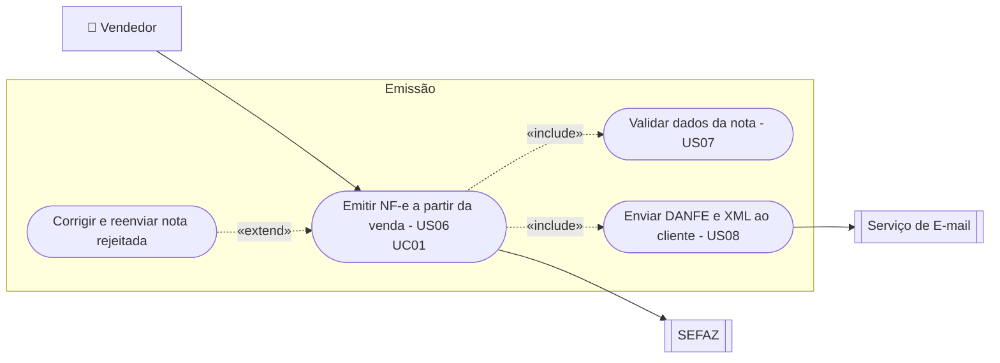
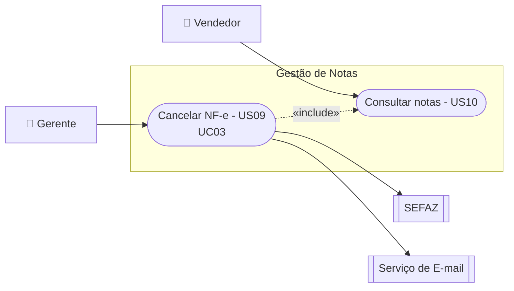
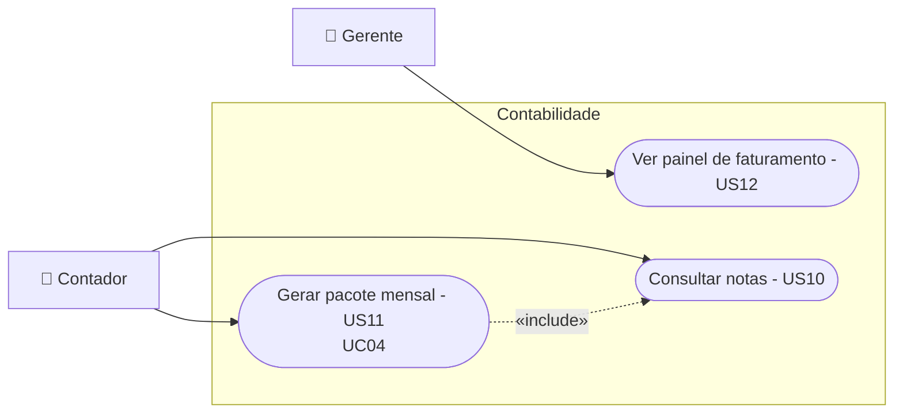

# Documento de Requisitos

**Projeto EmiteJá: Automação de Emissão de Nota Fiscal**
Revisão 1.0

| Elaboração | Elaboração | Elaboração | Aprovação |
|---|---|---|---|
| Abraão Gomes da Silva Araújo | Ednaldo Guilherme Lima Cordeiro | Kayk Thierry Araujo Silva | Rita Mendes |
| Equipe de desenvolvimento (Grupo04) | Equipe de desenvolvimento (Grupo04) | Equipe de desenvolvimento (Grupo04) | Cliente (fictícia), proprietária da Elétrica Ponto Certo |
| Data: 05/11/2026 | Data: 05/11/2026 | Data: 05/11/2026 | Data: 05/11/2026 |

## Registro de Alterações

| Versão | Responsável | Data | Alterações |
|---|---|---|---|
| 1.0 | Abraão, Ednaldo, Kayk | 05/11/2026 | Elaboração inicial do Documento de Requisitos do EmiteJá. |

## 1. Introdução

Este documento reúne os requisitos de usuário do EmiteJá. A seção 2 descreve o propósito do sistema; a seção 3 apresenta o minimundo e o problema enfrentado pelo cliente; a seção 4 lista os requisitos funcionais, as regras de negócio e os requisitos não funcionais; a seção 5 apresenta o modelo de casos de uso; a seção 6 traz os diagramas de atividades; e a seção 7 indica o protótipo.

## 2. Descrição do Propósito do Sistema

O EmiteJá é um sistema web que transforma a venda feita no balcão em nota fiscal eletrônica (NF-e) sem que o vendedor precise redigitar dados. Ele reaproveita os cadastros de clientes e produtos, confere os campos obrigatórios antes de enviar a nota à SEFAZ, entrega o documento ao cliente por e-mail e organiza todas as notas para consulta e para o fechamento mensal com a contabilidade.

## 3. Descrição do Minimundo

A Elétrica Ponto Certo é uma loja de materiais elétricos de bairro, de propriedade de Rita Mendes, que atende consumidores finais, eletricistas e pequenas construtoras. A equipe tem três vendedores que se revezam no balcão, uma gerente e um contador externo responsável pela escrituração.

Hoje a venda é anotada no sistema de caixa e, quando o cliente pede nota, o vendedor abre o emissor gratuito do estado e digita tudo de novo: dados do cliente, cada produto, NCM e CFOP. Nos horários de pico isso forma fila no balcão. Como os vendedores não dominam tributação, é comum a nota voltar rejeitada por NCM ou CFOP incorreto, e o vendedor só descobre depois de enviar. Cancelamentos são feitos por qualquer funcionário, sem registro de quem cancelou nem por quê. No fim do mês, a gerente procura os XMLs em pastas de computadores diferentes para mandar ao contador, e já aconteceu de notas ficarem de fora.

O EmiteJá deve permitir que a nota seja gerada a partir da venda já registrada, com os dados fiscais vindos do cadastro de produtos, que os erros sejam apontados antes do envio, que apenas a gerente possa cancelar notas e que o contador baixe sozinho o pacote do mês.

## 4. Requisitos de Usuário

Tomando por base o minimundo, foram identificados os seguintes requisitos de usuário.

### Requisitos Funcionais

| Identificador | Descrição | Prioridade | Depende de |
|---|---|---|---|
| US01 | Como vendedor, quero entrar no sistema com meu usuário e senha, para que as notas que eu emitir fiquem registradas em meu nome. | Alta | - |
| US02 | Como gerente, quero cadastrar os usuários da loja e definir o perfil de cada um (vendedor, gerente ou contador). | Alta | US01 |
| US03 | Como gerente, quero enviar o certificado digital A1 da loja e ser avisada antes do vencimento. | Alta | US01 |
| US04 | Como vendedor, quero cadastrar um cliente informando apenas o CNPJ e ter razão social e endereço preenchidos automaticamente. | Alta | US01 |
| US05 | Como gerente, quero cadastrar produtos com NCM, CFOP e unidade, para que o vendedor não precise conhecer tributação. | Alta | US01 |
| US06 | Como vendedor, quero registrar a venda no balcão e gerar a nota dela com um clique, sem redigitar dados. | Alta | US03, US04, US05 |
| US07 | Como vendedor, quero saber exatamente qual campo está errado antes do envio, para evitar nota rejeitada. | Alta | US06 |
| US08 | Como vendedor, quero que o cliente receba o DANFE e o XML por e-mail automaticamente após a autorização. | Média | US06 |
| US09 | Como gerente, quero cancelar uma nota emitida por engano informando a justificativa. | Alta | US06 |
| US10 | Como vendedor, quero buscar notas por cliente, número, período ou situação. | Média | US06 |
| US11 | Como contador, quero baixar em um único arquivo todas as notas do mês com um resumo. | Alta | US06, US09 |
| US12 | Como gerente, quero ver quanto foi faturado em notas no mês e quantas foram canceladas. | Média | US06, US09 |

### Regras de Negócio

| Identificador | Descrição | Prioridade | Requisitos Relacionados |
|---|---|---|---|
| RN01 | Uma venda só pode gerar uma única NF-e autorizada. | Alta | US06 |
| RN02 | Somente o perfil Gerente pode cancelar notas. | Alta | US02, US09 |
| RN03 | O cancelamento só é permitido em até 24 horas após a autorização. | Alta | US09 |
| RN04 | A justificativa de cancelamento deve ter no mínimo 15 caracteres. | Alta | US09 |
| RN05 | Produto sem NCM cadastrado não pode ser incluído em venda que gere nota. | Alta | US05, US07 |
| RN06 | CPF e CNPJ de clientes devem ter os dígitos verificadores conferidos no cadastro. | Alta | US04 |
| RN07 | O pacote mensal inclui apenas notas autorizadas ou canceladas de um mês já encerrado. | Alta | US11 |
| RN08 | O perfil Contador tem acesso somente de leitura às notas e aos pacotes mensais. | Alta | US02, US11 |
| RN09 | O sistema avisa a gerente 30 dias antes do vencimento do certificado A1 e bloqueia a emissão após o vencimento. | Média | US03 |

### Requisitos Não Funcionais

| Identificador | Descrição | Origem do requisito | Critérios de Aceitação | Categoria | Prioridade |
|---|---|---|---|---|---|
| RNF01 | A emissão deve ser rápida o suficiente para não formar fila no balcão. | Minimundo (fila no pico) | Do clique em "Gerar nota" até a resposta da SEFAZ, no máximo 10 segundos em 95% das emissões. | Desempenho | Alta |
| RNF02 | Senhas e certificado digital devem ser protegidos no servidor. | US01, US03 | Senhas armazenadas apenas como hash; certificado A1 armazenado criptografado. | Segurança | Alta |
| RNF03 | Todo acesso ao sistema deve ser feito por conexão segura. | US01 | 100% das requisições servidas via HTTPS. | Segurança | Alta |
| RNF04 | Um vendedor novo deve conseguir usar o sistema com pouco treinamento. | Minimundo (revezamento no balcão) | Vendedor emite a primeira nota sozinho após no máximo 15 minutos de treinamento. | Usabilidade | Média |
| RNF05 | O sistema deve estar disponível no horário de funcionamento da loja. | Minimundo | Disponibilidade de 99% entre 8h e 18h, de segunda a sábado. | Disponibilidade | Média |
| RNF06 | O XML gerado deve seguir o leiaute oficial da NF-e. | Legislação fiscal | 100% dos XMLs validados contra o schema vigente do Portal Nacional da NF-e. | Legal e regulatório | Alta |
| RNF07 | Os XMLs autorizados devem ser guardados pelo prazo legal. | Legislação fiscal | XMLs mantidos e recuperáveis por no mínimo 5 anos. | Legal e regulatório | Alta |

## 5. Modelo de Casos de Uso

Os atores identificados estão descritos na Tabela 1.

**Tabela 1: Atores**

| Ator | Descrição |
|---|---|
| Vendedor | Funcionário do balcão; registra vendas, cadastra clientes, emite e consulta notas. |
| Gerente | Responsável pela loja; herda as funções do Vendedor e também cancela notas, mantém produtos, usuários e certificado. |
| Contador | Profissional externo; consulta notas e baixa o pacote mensal, sem poder alterar nada. |
| SEFAZ | Sistema externo que autoriza notas e homologa cancelamentos. |
| Serviço de E-mail | Sistema externo que entrega DANFE e XML aos clientes. |
| Serviço de Consulta CNPJ | Sistema público externo que devolve razão social e endereço a partir do CNPJ. |

A seguir, os diagramas de casos de uso organizados por subsistema.

**Figura 1: Subsistema Acesso e Cadastros**

**Figura 2: Subsistema Emissão**

**Figura 3: Subsistema Gestão de Notas**

**Figura 4: Subsistema Contabilidade**

### 5.1 Descrição dos Casos de Uso

**Subsistema:** Emissão
**Identificador do Caso de Uso:** UC01
**Caso de Uso:** Emitir NF-e a partir da venda
**Descrição Sucinta:** Transforma uma venda registrada em NF-e autorizada e a entrega ao cliente.
**Pré-condições:** Vendedor autenticado; certificado A1 válido; cliente e produtos cadastrados.

| Nome do Fluxo | Pré-condição | Descrição |
|---|---|---|
| Emissão a partir da venda | Venda registrada | 1. O Vendedor registra a venda (cliente, produtos, quantidades, pagamento). 2. Seleciona "Gerar nota". 3. O sistema monta a nota com os dados da venda e dos cadastros. 4. O sistema valida os campos obrigatórios. 5. O sistema assina e envia a nota à SEFAZ. 6. A SEFAZ autoriza. 7. O sistema armazena o XML, gera o DANFE e envia ambos ao e-mail do cliente. |

| Fluxo Relacionado | Variante | Descrição |
|---|---|---|
| Emissão a partir da venda | Passo 4: dados inválidos | O sistema lista cada erro (ex.: produto sem NCM) e leva o Vendedor ao cadastro; após a correção, volta ao passo 3. |
| Emissão a partir da venda | Passo 7: cliente sem e-mail | O sistema oferece a impressão do DANFE. |

| Fluxo Relacionado | Condição de Exceção | Descrição |
|---|---|---|
| Emissão a partir da venda | Passo 6: rejeição | O sistema mostra código e motivo, marca a nota como "Rejeitada" e permite corrigir e reenviar. |
| Emissão a partir da venda | Passo 5: SEFAZ sem resposta | A nota fica "Pendente" e o sistema reenvia automaticamente a cada 2 minutos, avisando o Vendedor. |

**Subsistema:** Acesso e Cadastros
**Identificador do Caso de Uso:** UC02
**Caso de Uso:** Manter cliente
**Descrição Sucinta:** Cadastra ou atualiza um cliente para uso nas vendas.
**Pré-condições:** Usuário autenticado.

| Nome do Fluxo | Pré-condição | Descrição |
|---|---|---|
| Cadastro de cliente | N/A | 1. O Vendedor escolhe "Novo cliente" e informa CPF ou CNPJ. 2. O sistema confere os dígitos verificadores. 3. Sendo CNPJ, o sistema consulta o serviço público e preenche razão social e endereço. 4. O Vendedor completa telefone e e-mail e confirma. 5. O sistema salva o cliente. |

| Fluxo Relacionado | Variante | Descrição |
|---|---|---|
| Cadastro de cliente | Passo 1: documento já cadastrado | O sistema abre o cadastro existente para edição. |
| Cadastro de cliente | Passo 3: serviço indisponível | O Vendedor preenche os dados manualmente. |

| Fluxo Relacionado | Condição de Exceção | Descrição |
|---|---|---|
| Cadastro de cliente | Passo 2: documento inválido | O sistema informa o erro e não prossegue. |

**Subsistema:** Gestão de Notas
**Identificador do Caso de Uso:** UC03
**Caso de Uso:** Cancelar NF-e
**Descrição Sucinta:** Cancela uma nota autorizada emitida por engano.
**Pré-condições:** Gerente autenticada; nota com situação "Autorizada".

| Nome do Fluxo | Pré-condição | Descrição |
|---|---|---|
| Cancelamento | Nota autorizada | 1. A Gerente localiza a nota na consulta. 2. Seleciona "Cancelar" e informa a justificativa. 3. O sistema verifica prazo (RN03) e justificativa (RN04). 4. O sistema envia o evento de cancelamento à SEFAZ. 5. A SEFAZ homologa. 6. O sistema marca a nota como "Cancelada" e avisa o cliente por e-mail. |

| Fluxo Relacionado | Variante | Descrição |
|---|---|---|
| Não se aplica. | Não se aplica. | Não se aplica. |

| Fluxo Relacionado | Condição de Exceção | Descrição |
|---|---|---|
| Cancelamento | Passo 3: prazo expirado | O sistema bloqueia o cancelamento e orienta procurar o contador. |
| Cancelamento | Passo 5: recusa da SEFAZ | O sistema mostra o motivo e mantém a nota "Autorizada". |

**Subsistema:** Contabilidade
**Identificador do Caso de Uso:** UC04
**Caso de Uso:** Gerar pacote mensal
**Descrição Sucinta:** Reúne os documentos fiscais de um mês para a escrituração.
**Pré-condições:** Contador autenticado; mês selecionado encerrado.

| Nome do Fluxo | Pré-condição | Descrição |
|---|---|---|
| Fechamento mensal | Mês encerrado | 1. O Contador acessa "Fechamento mensal" e escolhe o mês. 2. O sistema reúne as notas autorizadas e canceladas (RN07). 3. O sistema gera um resumo em PDF com quantidade, valor total e cancelamentos. 4. O sistema compacta XMLs e resumo em um .zip. 5. O Contador faz o download. |

| Fluxo Relacionado | Variante | Descrição |
|---|---|---|
| Fechamento mensal | Passo 2: notas pendentes ou rejeitadas | O sistema lista essas notas e avisa a Gerente antes de gerar o pacote. |

| Fluxo Relacionado | Condição de Exceção | Descrição |
|---|---|---|
| Fechamento mensal | Passo 2: nenhuma nota no mês | O sistema informa que não há notas e não gera o pacote. |

### 5.2 Modelo de Casos de Uso Expandido

**Caso de Uso:** Emitir NF-e a partir da venda · **Ator(es):** Vendedor, SEFAZ, Serviço de E-mail
**Finalidade:** Gerar a NF-e da venda sem redigitação. · **Pré-condição:** Vendedor autenticado; certificado válido.

| Ação do Ator | Resposta do Sistema |
|---|---|
| 1. Registra a venda e seleciona "Gerar nota". | |
| | 2. Monta a nota com os dados da venda e dos cadastros. |
| | 3. Valida os campos obrigatórios. |
| | 4. Assina e envia à SEFAZ; recebe a autorização. |
| | 5. Armazena o XML, gera o DANFE e envia ao cliente. |

Cenário alternativo: 3.1 Dados inválidos: lista os erros e direciona ao cadastro. 5.1 Cliente sem e-mail: oferece impressão.
Cenário excepcional: 4.1 Rejeição: mostra o motivo e permite reenviar. 4.2 SEFAZ sem resposta: nota "Pendente" com reenvio automático.
**Pós-condição:** Nota autorizada, armazenada e entregue ao cliente.

**Caso de Uso:** Manter cliente · **Ator(es):** Vendedor, Serviço de Consulta CNPJ
**Finalidade:** Cadastrar ou atualizar clientes. · **Pré-condição:** Usuário autenticado.

| Ação do Ator | Resposta do Sistema |
|---|---|
| 1. Escolhe "Novo cliente" e informa CPF/CNPJ. | |
| | 2. Confere os dígitos e consulta o CNPJ. |
| | 3. Preenche razão social e endereço. |
| 4. Completa telefone e e-mail e confirma. | |
| | 5. Salva o cliente. |

Cenário alternativo: 1.1 Documento já cadastrado: abre para edição. 3.1 Serviço indisponível: preenchimento manual.
Cenário excepcional: 2.1 Documento inválido: informa o erro.
**Pós-condição:** Cliente disponível na busca de vendas.

**Caso de Uso:** Cancelar NF-e · **Ator(es):** Gerente, SEFAZ, Serviço de E-mail
**Finalidade:** Cancelar nota emitida por engano. · **Pré-condição:** Nota "Autorizada" há menos de 24 horas.

| Ação do Ator | Resposta do Sistema |
|---|---|
| 1. Localiza a nota e seleciona "Cancelar". | |
| 2. Informa a justificativa. | |
| | 3. Verifica prazo e justificativa. |
| | 4. Envia o evento à SEFAZ e recebe a homologação. |
| | 5. Marca a nota como "Cancelada" e avisa o cliente. |

Cenário excepcional: 3.1 Prazo expirado: bloqueia. 4.1 Recusa da SEFAZ: mantém "Autorizada" e mostra o motivo.
**Pós-condição:** Nota cancelada com justificativa e autor registrados.

**Caso de Uso:** Gerar pacote mensal · **Ator(es):** Contador
**Finalidade:** Entregar à contabilidade os documentos do mês. · **Pré-condição:** Mês encerrado.

| Ação do Ator | Resposta do Sistema |
|---|---|
| 1. Acessa "Fechamento mensal" e escolhe o mês. | |
| | 2. Reúne notas autorizadas e canceladas. |
| | 3. Gera o resumo em PDF e compacta tudo em .zip. |
| 4. Faz o download. | |

Cenário alternativo: 2.1 Notas pendentes ou rejeitadas: avisa a Gerente antes de gerar.
Cenário excepcional: 2.2 Nenhuma nota no mês: não gera o pacote.
**Pós-condição:** Pacote disponível e registrado no histórico.

