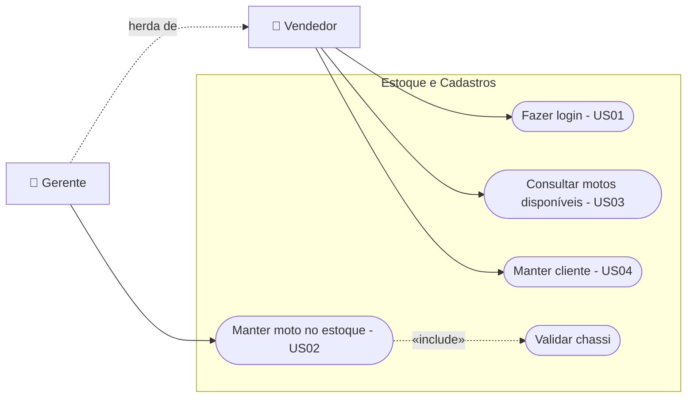
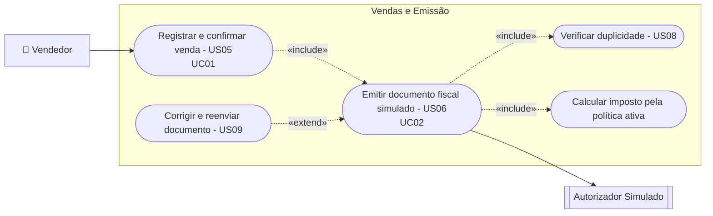
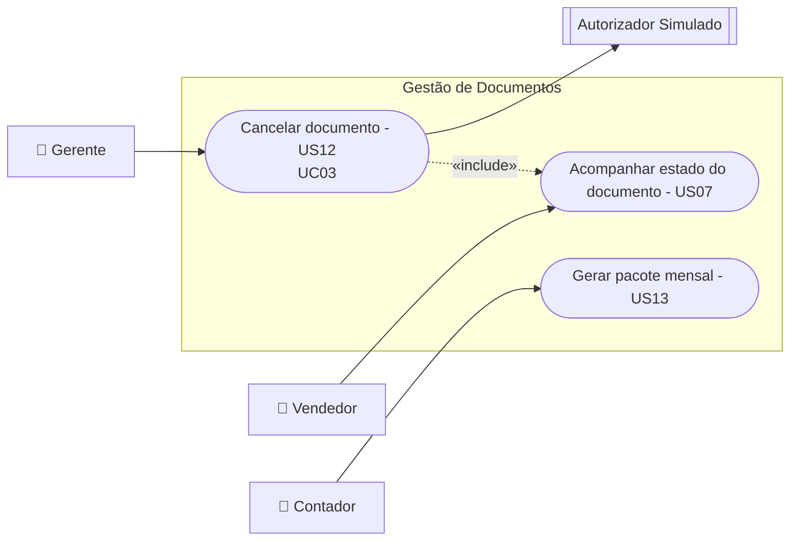
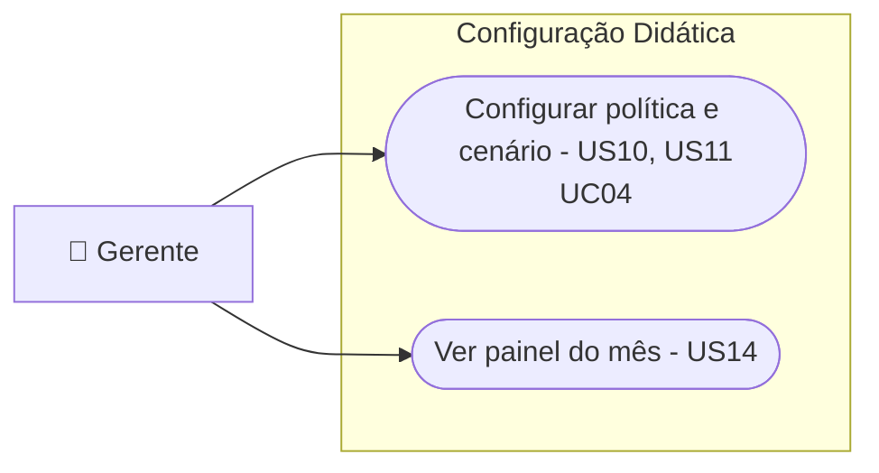
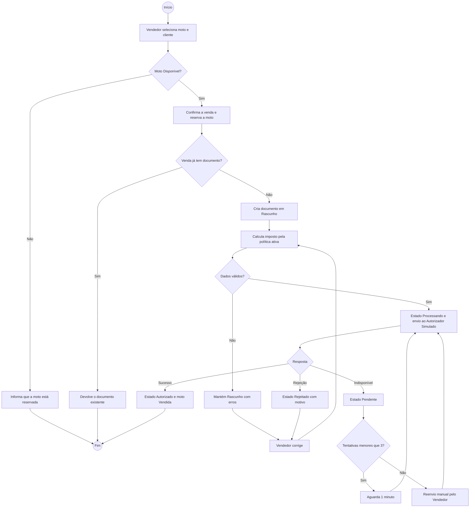
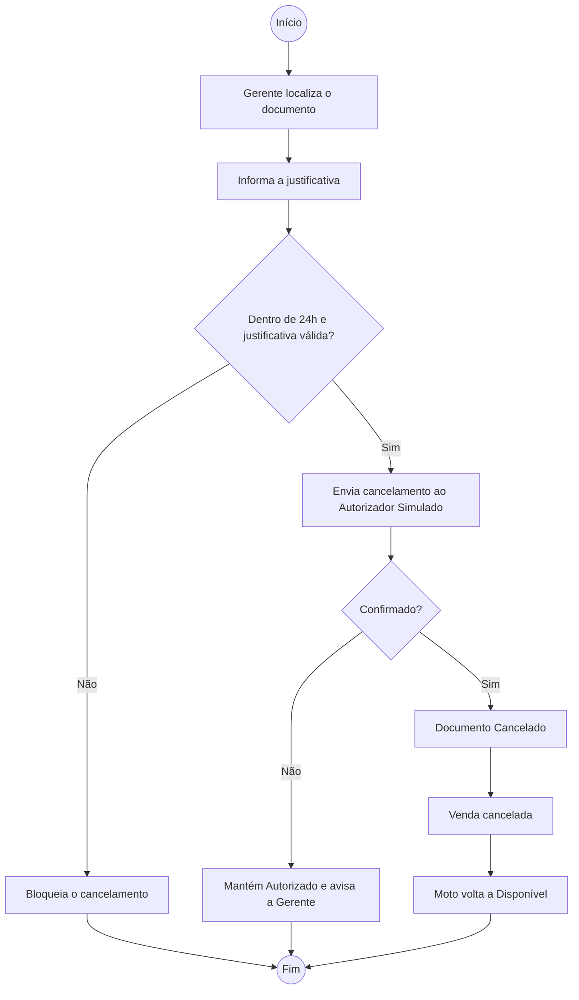
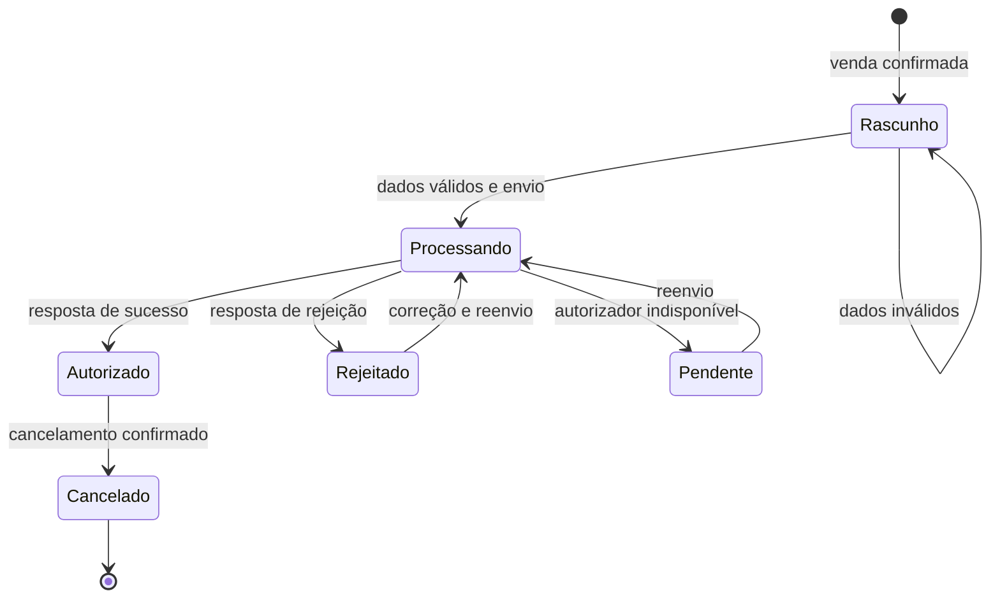

# Documento de Requisitos

**Projeto EmiteJá: Automação de Emissão de Nota Fiscal e Gestão de Venda de Motos**
Revisão 2.1

| Elaboração | Elaboração | Elaboração | Aprovação |
|---|---|---|---|
| Abraão Gomes da Silva Araújo | Ednaldo Guilherme Lima Cordeiro | Kayk Thierry Araujo Silva | Rita Mendes |
| Equipe de desenvolvimento (Grupo 04) | Equipe de desenvolvimento (Grupo 04) | Equipe de desenvolvimento (Grupo 04) | Cliente (fictícia), proprietária da Rota Motos |
| Data: 05/11/2026 | Data: 05/11/2026 | Data: 05/11/2026 | Data: 05/11/2026 |

## Registro de Alterações

| Versão | Responsável | Data | Alterações |
|---|---|---|---|
| 1.0 | Abraão, Ednaldo, Kayk | 05/11/2026 | Elaboração inicial do Documento de Requisitos do EmiteJá. |
| 2.0 | Abraão, Ednaldo, Kayk | 05/11/2026 | Adequação ao tema do Grupo 04: inclusão da gestão de venda de motos, emissão simulada, contrato de integração, estados de processamento, prevenção de emissão duplicada e política didática de cálculo de imposto. |
| 2.1 | Abraão | 11/11/2026 | Seção 8: protótipo publicado (tecnologias, telas, testes automatizados e dados de demonstração). |

## 1. Introdução

Este documento reúne os requisitos de usuário do EmiteJá, tema do Grupo 04: automação de emissão de nota fiscal e gestão de venda de motos. A seção 2 descreve o propósito do sistema; a seção 3 apresenta o minimundo e declara o escopo adotado; a seção 4 lista os requisitos funcionais, as regras de negócio, os requisitos não funcionais e a política didática de cálculo; a seção 5 apresenta o modelo de casos de uso; a seção 6 traz os diagramas de atividades; a seção 7 descreve os estados de processamento e o contrato de integração simulado; e a seção 8 indica o protótipo.

## 2. Descrição do Propósito do Sistema

O EmiteJá é um sistema web para revendas de motos que une o controle de estoque e de vendas à emissão do documento fiscal da venda. Ao confirmar a venda de uma moto, o sistema gera automaticamente o documento fiscal com os dados da moto, do cliente e do pagamento, envia o documento a um autorizador por meio de um contrato de integração, acompanha cada estado do processamento e impede que a mesma venda gere dois documentos. Por ser um projeto acadêmico, a autorização é **simulada**: nenhum documento tem valor fiscal e nenhum serviço governamental é acessado.

## 3. Descrição do Minimundo

A Rota Motos é uma revenda de motos novas de propriedade de Rita Mendes. A loja tem três vendedores, uma gerente e um contador externo. O estoque fica em uma planilha, e cada moto é identificada pelo número do chassi.

Quando um cliente fecha negócio, o vendedor confere na planilha se a moto ainda está disponível, anota a venda em papel e depois digita a nota fiscal em outro programa, copiando chassi, modelo, cor e valores. Já aconteceu de duas vendas serem feitas para a mesma moto, porque a planilha não foi atualizada a tempo, e de a mesma venda gerar duas notas, porque o vendedor clicou de novo ao achar que o programa tinha travado. Erros de digitação no chassi provocam rejeição da nota, e o vendedor não sabe em que situação a nota está: se foi enviada, se foi aceita ou se precisa ser refeita. O cálculo do imposto é feito à mão pela gerente, e a loja quer comparar formas diferentes de calcular antes de padronizar uma.

### 3.1 Escopo Adotado e Relação entre os Elementos

O sistema trata dois elementos ligados por uma relação de dependência:

- **Gestão de venda de motos:** cadastro de motos no estoque, cadastro de clientes, registro e confirmação de vendas e controle da situação de cada moto (Disponível, Reservada, Vendida).
- **Emissão de documento fiscal:** geração, validação, envio ao autorizador, acompanhamento de estados, cancelamento e consulta dos documentos.

**Relação:** a venda é a origem do documento. Toda venda confirmada gera exatamente um documento fiscal, e o documento só pode existir vinculado a uma venda. O resultado da emissão volta para a venda e para o estoque: com o documento autorizado, a moto passa a Vendida; com o documento cancelado, a venda é cancelada e a moto volta a Disponível.

**Dentro do escopo:** emissão **simulada** de documento para venda válida; estados de processamento; prevenção de emissão duplicada; contrato de integração com respostas simuladas de sucesso e de falha; política de cálculo de imposto variável e explicitamente didática.

**Fora do escopo:** emissão fiscal real, certificado digital, comunicação com SEFAZ ou qualquer serviço governamental, financiamento, emplacamento, controle de peças e oficina.

## 4. Requisitos de Usuário

Tomando por base o minimundo e o escopo adotado, foram identificados os seguintes requisitos de usuário.

### Requisitos Funcionais

| Identificador | Descrição | Prioridade | Depende de |
|---|---|---|---|
| US01 | Como vendedor, quero entrar no sistema com meu usuário e senha, para que minhas vendas fiquem registradas em meu nome. | Alta | - |
| US02 | Como gerente, quero cadastrar motos no estoque com chassi, marca, modelo, cilindrada, ano, cor e preço. | Alta | US01 |
| US03 | Como vendedor, quero consultar as motos disponíveis filtrando por modelo, cilindrada e preço. | Alta | US02 |
| US04 | Como vendedor, quero cadastrar o cliente com CPF ou CNPJ, nome, endereço e e-mail. | Alta | US01 |
| US05 | Como vendedor, quero registrar a venda de uma moto disponível para um cliente, informando a forma de pagamento. | Alta | US03, US04 |
| US06 | Como vendedor, quero que, ao confirmar a venda, o documento fiscal seja gerado e enviado automaticamente. | Alta | US05 |
| US07 | Como vendedor, quero ver em que estado está o documento (Rascunho, Processando, Autorizado, Rejeitado, Pendente, Cancelado). | Alta | US06 |
| US08 | Como vendedor, quero que clicar de novo em "Emitir" não gere um segundo documento para a mesma venda. | Alta | US06 |
| US09 | Como vendedor, quero ver o motivo de uma rejeição, corrigir os dados e reenviar o mesmo documento. | Alta | US07 |
| US10 | Como gerente, quero escolher qual política de cálculo de imposto está ativa, para comparar as variantes. | Alta | US06 |
| US11 | Como gerente, quero definir o cenário de resposta do autorizador simulado (sucesso, rejeição ou indisponível), para demonstrar cada caminho. | Alta | US06 |
| US12 | Como gerente, quero cancelar um documento autorizado informando a justificativa, devolvendo a moto ao estoque. | Alta | US07 |
| US13 | Como contador, quero consultar os documentos do mês e baixá-los em um único arquivo com resumo. | Média | US07 |
| US14 | Como gerente, quero ver no painel as vendas e os documentos do mês por estado e o total de imposto calculado. | Média | US07, US10 |

### Regras de Negócio

| Identificador | Descrição | Prioridade | Requisitos Relacionados |
|---|---|---|---|
| RN01 | Cada venda gera no máximo um documento fiscal não cancelado. A chave de idempotência do documento é o código da venda. | Alta | US06, US08 |
| RN02 | Uma nova solicitação de emissão para uma venda que já tem documento devolve o documento existente, sem novo envio ao autorizador. | Alta | US08 |
| RN03 | Só moto Disponível pode entrar em uma venda. Ao confirmar a venda, a moto passa a Reservada; com o documento Autorizado, passa a Vendida. | Alta | US05, US06 |
| RN04 | O chassi deve ter 17 caracteres alfanuméricos, sem as letras I, O e Q, e ser único no estoque. | Alta | US02 |
| RN05 | CPF e CNPJ devem ter os dígitos verificadores conferidos. | Alta | US04 |
| RN06 | O imposto é calculado pela política ativa no momento da emissão. O documento registra a política usada e não é recalculado se a política mudar depois. | Alta | US10 |
| RN07 | Se o autorizador não responder, o documento fica Pendente e o sistema tenta reenviar até 3 vezes, com intervalo de 1 minuto. Esgotadas as tentativas, o reenvio passa a ser manual. | Alta | US07, US11 |
| RN08 | Somente o perfil Gerente cancela documentos, em até 24 horas após a autorização e com justificativa de no mínimo 15 caracteres. | Alta | US12 |
| RN09 | O cancelamento do documento cancela a venda e devolve a moto a Disponível. | Alta | US12 |
| RN10 | O perfil Contador tem acesso somente de leitura. | Alta | US13 |

### Requisitos Não Funcionais

| Identificador | Descrição | Origem do requisito | Critérios de Aceitação | Categoria | Prioridade |
|---|---|---|---|---|---|
| RNF01 | O sistema não realiza emissão fiscal real. | Enunciado do tema | Todo documento exibe "SEM VALOR FISCAL - SIMULAÇÃO" e nenhuma requisição é feita a serviço governamental. | Legal e regulatório | Alta |
| RNF02 | A integração com o autorizador segue um contrato definido e substituível. | Enunciado do tema | Requisição e resposta seguem o contrato da seção 7.2; trocar o simulador não exige alterar as regras de negócio. | Manutenibilidade | Alta |
| RNF03 | Toda mudança de estado do documento é rastreável. | US07 | Cada transição é registrada com estado anterior, novo estado, data, hora e usuário. | Rastreabilidade | Alta |
| RNF04 | A emissão deve ser rápida para não atrasar a entrega da moto. | Minimundo | Da confirmação da venda até a resposta do simulador, no máximo 5 segundos. | Desempenho | Média |
| RNF05 | Senhas protegidas e acesso por conexão segura. | US01 | Senhas armazenadas apenas como hash; 100% das requisições via HTTPS. | Segurança | Alta |
| RNF06 | As regras de cálculo e as respostas da integração devem ser verificáveis. | US10, US11 | Testes automatizados cobrem as duas variantes da política e os três cenários do simulador. | Testabilidade | Alta |
| RNF07 | O vendedor deve emitir sem treinamento extenso. | Minimundo | Vendedor novo registra uma venda e emite o documento após no máximo 15 minutos de treinamento. | Usabilidade | Média |

### 4.1 Política Didática de Cálculo de Imposto

Para atender ao desafio de variar uma política de cálculo, o EmiteJá oferece duas variantes intercambiáveis. **As alíquotas são fictícias e têm finalidade exclusivamente didática**; não correspondem à legislação tributária.

| Variante | Regra | Exemplo: moto de 300 cc por R$ 25.000,00 |
|---|---|---|
| A: Alíquota única | 10% sobre o valor da venda, qualquer que seja a moto. | R$ 2.500,00 |
| B: Por cilindrada | Até 160 cc: 8%. De 161 a 500 cc: 12%. Acima de 500 cc: 18%. | R$ 3.000,00 |

A gerente escolhe a variante ativa (US10). A variante é aplicada no momento da emissão e fica gravada no documento (RN06), o que permite comparar o efeito de cada política sobre as mesmas vendas.

## 5. Modelo de Casos de Uso

Os atores identificados estão descritos na Tabela 1.

**Tabela 1: Atores**

| Ator | Descrição |
|---|---|
| Vendedor | Funcionário da loja; consulta o estoque, cadastra clientes, registra vendas e acompanha os documentos. |
| Gerente | Responsável pela loja; herda as funções do Vendedor e também mantém o estoque, cancela documentos e configura a política de imposto e o cenário do simulador. |
| Contador | Profissional externo; consulta documentos e baixa o pacote mensal, sem poder alterar nada. |
| Autorizador Simulado | Sistema externo simulado que recebe o documento pelo contrato de integração e responde com sucesso, rejeição ou indisponibilidade. |

A seguir, os diagramas de casos de uso organizados por subsistema.

**Figura 1: Subsistema Estoque e Cadastros**



**Figura 2: Subsistema Vendas e Emissão**



**Figura 3: Subsistema Gestão de Documentos**



**Figura 4: Subsistema Configuração Didática**



### 5.1 Descrição dos Casos de Uso

**Subsistema:** Vendas e Emissão
**Identificador do Caso de Uso:** UC01
**Caso de Uso:** Registrar e confirmar venda
**Descrição Sucinta:** Registra a venda de uma moto disponível para um cliente e, ao confirmar, dispara a emissão do documento.
**Pré-condições:** Vendedor autenticado; moto Disponível; cliente cadastrado.

| Nome do Fluxo | Pré-condição | Descrição |
|---|---|---|
| Venda de moto | Moto Disponível | 1. O Vendedor busca a moto no estoque e a seleciona. 2. Seleciona o cliente. 3. Informa a forma de pagamento. 4. O sistema exibe o resumo com valor da moto. 5. O Vendedor confirma a venda. 6. O sistema marca a moto como Reservada e inicia a emissão (UC02). |

| Fluxo Relacionado | Variante | Descrição |
|---|---|---|
| Venda de moto | Passo 2: cliente não cadastrado | O Vendedor cadastra o cliente (Manter cliente) e retorna ao passo 2. |

| Fluxo Relacionado | Condição de Exceção | Descrição |
|---|---|---|
| Venda de moto | Passo 5: moto deixou de estar Disponível | O sistema informa que a moto foi reservada em outra venda e cancela a operação (RN03). |

**Subsistema:** Vendas e Emissão
**Identificador do Caso de Uso:** UC02
**Caso de Uso:** Emitir documento fiscal simulado
**Descrição Sucinta:** Gera, valida e envia o documento da venda ao Autorizador Simulado, controlando estados e duplicidade.
**Pré-condições:** Venda confirmada.

| Nome do Fluxo | Pré-condição | Descrição |
|---|---|---|
| Emissão simulada | Venda confirmada | 1. O sistema verifica se a venda já tem documento (RN01). 2. Cria o documento em Rascunho com os dados da venda. 3. Calcula o imposto pela política ativa e grava a política usada (RN06). 4. Valida os dados (chassi, documento do cliente, valores). 5. Muda o estado para Processando e envia a requisição pelo contrato de integração. 6. O Autorizador Simulado responde com sucesso. 7. O sistema muda o estado para Autorizado, registra o protocolo e marca a moto como Vendida. |

| Fluxo Relacionado | Variante | Descrição |
|---|---|---|
| Emissão simulada | Passo 1: venda já tem documento | O sistema devolve o documento existente e não envia nada ao autorizador (RN02). |
| Emissão simulada | Passo 4: dados inválidos | O documento permanece em Rascunho com a lista de erros para correção. |

| Fluxo Relacionado | Condição de Exceção | Descrição |
|---|---|---|
| Emissão simulada | Passo 6: resposta de rejeição | O estado passa a Rejeitado com código e motivo; o Vendedor corrige e reenvia o mesmo documento. |
| Emissão simulada | Passo 6: autorizador indisponível | O estado passa a Pendente e o sistema reenvia automaticamente até 3 vezes (RN07). |

**Subsistema:** Gestão de Documentos
**Identificador do Caso de Uso:** UC03
**Caso de Uso:** Cancelar documento
**Descrição Sucinta:** Cancela um documento autorizado e desfaz a venda.
**Pré-condições:** Gerente autenticada; documento Autorizado há menos de 24 horas.

| Nome do Fluxo | Pré-condição | Descrição |
|---|---|---|
| Cancelamento | Documento Autorizado | 1. A Gerente localiza o documento. 2. Seleciona "Cancelar" e informa a justificativa. 3. O sistema verifica prazo e justificativa (RN08). 4. Envia o pedido de cancelamento ao Autorizador Simulado. 5. O autorizador confirma. 6. O sistema marca o documento como Cancelado, cancela a venda e devolve a moto a Disponível (RN09). |

| Fluxo Relacionado | Variante | Descrição |
|---|---|---|
| Não se aplica. | Não se aplica. | Não se aplica. |

| Fluxo Relacionado | Condição de Exceção | Descrição |
|---|---|---|
| Cancelamento | Passo 3: prazo expirado ou justificativa curta | O sistema bloqueia o cancelamento e informa o motivo. |
| Cancelamento | Passo 5: autorizador indisponível | O documento continua Autorizado e a Gerente é avisada para tentar novamente. |

**Subsistema:** Configuração Didática
**Identificador do Caso de Uso:** UC04
**Caso de Uso:** Configurar política e cenário
**Descrição Sucinta:** Permite à Gerente escolher a política de cálculo de imposto ativa e o cenário de resposta do Autorizador Simulado.
**Pré-condições:** Gerente autenticada.

| Nome do Fluxo | Pré-condição | Descrição |
|---|---|---|
| Configuração | N/A | 1. A Gerente acessa "Configurações". 2. O sistema exibe a política ativa e o cenário atual do simulador. 3. A Gerente escolhe a variante A ou B e o cenário Sucesso, Rejeição ou Indisponível. 4. O sistema mostra um exemplo de cálculo com a variante escolhida. 5. A Gerente confirma e o sistema registra a alteração com data e usuário. |

| Fluxo Relacionado | Variante | Descrição |
|---|---|---|
| Configuração | Passo 3: só o cenário é alterado | A política ativa permanece a mesma. |

| Fluxo Relacionado | Condição de Exceção | Descrição |
|---|---|---|
| Configuração | Passo 5: há documentos em Processando | O sistema aplica a nova configuração somente às próximas emissões. |

### 5.2 Modelo de Casos de Uso Expandido

**Caso de Uso:** Registrar e confirmar venda · **Ator(es):** Vendedor
**Finalidade:** Vender uma moto disponível e disparar a emissão. · **Pré-condição:** Moto Disponível; cliente cadastrado.

| Ação do Ator | Resposta do Sistema |
|---|---|
| 1. Seleciona a moto e o cliente. | |
| 2. Informa a forma de pagamento. | |
| | 3. Exibe o resumo da venda. |
| 4. Confirma a venda. | |
| | 5. Marca a moto como Reservada e inicia a emissão. |

Cenário alternativo: 1.1 Cliente não cadastrado: abre o cadastro e retorna.
Cenário excepcional: 4.1 Moto reservada em outra venda: cancela a operação.
**Pós-condição:** Venda confirmada, moto Reservada e documento em emissão.

**Caso de Uso:** Emitir documento fiscal simulado · **Ator(es):** Vendedor, Autorizador Simulado
**Finalidade:** Obter o documento autorizado da venda sem duplicidade. · **Pré-condição:** Venda confirmada.

| Ação do Ator | Resposta do Sistema |
|---|---|
| 1. Solicita a emissão (automática após a venda ou pelo botão "Emitir"). | |
| | 2. Verifica se já existe documento para a venda. |
| | 3. Cria o Rascunho, calcula o imposto e valida os dados. |
| | 4. Muda para Processando e envia pelo contrato de integração. |
| | 5. Recebe sucesso, muda para Autorizado e marca a moto como Vendida. |

Cenário alternativo: 2.1 Documento já existe: devolve o existente sem reenviar. 3.1 Dados inválidos: mantém Rascunho com os erros.
Cenário excepcional: 5.1 Rejeição: estado Rejeitado com motivo. 5.2 Indisponível: estado Pendente com reenvio automático.
**Pós-condição:** Um único documento Autorizado vinculado à venda.

**Caso de Uso:** Cancelar documento · **Ator(es):** Gerente, Autorizador Simulado
**Finalidade:** Desfazer uma venda com documento autorizado. · **Pré-condição:** Documento Autorizado há menos de 24 horas.

| Ação do Ator | Resposta do Sistema |
|---|---|
| 1. Localiza o documento e seleciona "Cancelar". | |
| 2. Informa a justificativa. | |
| | 3. Verifica prazo e justificativa. |
| | 4. Envia o cancelamento ao autorizador e recebe a confirmação. |
| | 5. Marca Cancelado, cancela a venda e devolve a moto ao estoque. |

Cenário excepcional: 3.1 Prazo expirado ou justificativa curta: bloqueia. 4.1 Autorizador indisponível: mantém Autorizado.
**Pós-condição:** Documento Cancelado e moto Disponível.

**Caso de Uso:** Configurar política e cenário · **Ator(es):** Gerente
**Finalidade:** Alternar a política didática de imposto e o comportamento do simulador. · **Pré-condição:** Gerente autenticada.

| Ação do Ator | Resposta do Sistema |
|---|---|
| 1. Acessa "Configurações". | |
| | 2. Exibe política ativa e cenário atual. |
| 3. Escolhe a variante e o cenário. | |
| | 4. Mostra um exemplo de cálculo. |
| 5. Confirma. | |
| | 6. Registra a alteração com data e usuário. |

Cenário excepcional: 5.1 Documentos em Processando: aplica só às próximas emissões.
**Pós-condição:** Nova configuração ativa para as próximas emissões.

## 6. Diagramas de Atividades

**Figura 5: Processo de venda e emissão simulada**



**Figura 6: Processo de cancelamento de documento**



## 7. Estados de Processamento e Contrato de Integração

### 7.1 Estados do Documento Fiscal

**Figura 7: Diagrama de estados do documento fiscal**



| Estado | Significado | Pode reenviar? | Situação da moto |
|---|---|---|---|
| Rascunho | Documento criado, ainda não enviado ou com erros de validação. | Sim, após correção | Reservada |
| Processando | Requisição enviada e aguardando resposta. Novos pedidos de emissão devolvem este mesmo documento. | Não | Reservada |
| Autorizado | Autorizador simulado aceitou o documento e devolveu protocolo. | Não | Vendida |
| Rejeitado | Autorizador simulado recusou com código e motivo. | Sim, após correção | Reservada |
| Pendente | Autorizador não respondeu; reenvio automático em andamento. | Sim | Reservada |
| Cancelado | Cancelamento confirmado pelo autorizador. | Não | Disponível |

### 7.2 Contrato de Integração Simulado

A comunicação com o Autorizador Simulado usa requisições e respostas em JSON. O simulador não acessa nenhum serviço externo; seu comportamento é definido pelo cenário configurado pela Gerente (UC04).

**Requisição de emissão** (`POST /autorizador/documentos`):

```json
{
  "chaveIdempotencia": "VENDA-2026-000123",
  "venda": { "codigo": "2026-000123", "data": "2026-11-05", "formaPagamento": "PIX" },
  "destinatario": { "documento": "123.456.789-09", "nome": "Cliente Exemplo" },
  "item": { "chassi": "9C2KC2210RR000123", "descricao": "Moto 300 cc, 2026, vermelha", "cilindrada": 300 },
  "valores": { "venda": 25000.00, "politicaImposto": "B_POR_CILINDRADA", "aliquota": 0.12, "imposto": 3000.00 }
}
```

**Resposta de sucesso** (HTTP 200):

```json
{ "status": "AUTORIZADO", "protocolo": "SIM-000981", "dataHora": "2026-11-05T14:32:10", "aviso": "SEM VALOR FISCAL - SIMULAÇÃO" }
```

**Resposta de falha por rejeição** (HTTP 422):

```json
{ "status": "REJEITADO", "codigo": "R01", "motivo": "Chassi com formato inválido" }
```

**Resposta de falha por indisponibilidade** (HTTP 503): sem corpo; o EmiteJá trata como Pendente (RN07).

**Requisição repetida com a mesma chave de idempotência:** o simulador devolve a mesma resposta da primeira requisição, sem gerar novo protocolo. Isso reforça, do lado do autorizador, a prevenção de duplicidade garantida pelo EmiteJá (RN01, RN02).

## 8. Protótipo do Sistema

O protótipo está no repositório do projeto: telas na pasta `public/` (issue #6) e código da emissão simulada com testes em `src/` e `testes/` (issue #7). As instruções para executar estão no README.

### 8.1 Tecnologias

Node.js 22 ou superior, Express 5 e banco SQLite embutido (`node:sqlite`), sem serviços externos. As telas usam HTML, CSS e JavaScript sem framework. O código segue a arquitetura do projeto preliminar: domínio (`src/dominio`), aplicação (`src/aplicacao`), infraestrutura (`src/infra`) e interface (`public/`). O autorizador simulado implementa o contrato da seção 7.2.

### 8.2 Telas

| Tela | Perfis | Requisitos atendidos |
|---|---|---|
| Entrada | Todos | US01 |
| Nova venda | Vendedor, Gerente | US03, US05, US06; RN03 (moto reservada na confirmação); prévia do imposto pela política ativa |
| Documentos | Todos | US07; filtro por estado de processamento (seção 7.1) |
| Documento (cupom) | Todos; ações por perfil | US07, US08, US09, US12; RN01 e RN02 (pedir de novo não duplica); RN07 (reenvio); RN08 e RN09 (cancelamento); histórico de transições |
| Clientes | Vendedor, Gerente | US04; validação de CPF e CNPJ (RN05) |
| Estoque | Vendedor, Gerente; cadastro só Gerente | US02, US03; validação de chassi (RN04) |
| Painel do mês | Gerente, Contador | US13, US14 |
| Configurações | Gerente | US10, US11 |

Todas as telas mostram a faixa "SIMULAÇÃO · sem valor fiscal" com a política ativa e o cenário do autorizador, e o documento traz o selo "SEM VALOR FISCAL".

### 8.3 Testes automatizados

São 24 testes (`npm test`), todos aprovados:

- **Domínio:** chassi (RN04), CPF e CNPJ (RN05), variantes A e B da política, incluindo o exemplo de 300 cc por R$ 25.000,00, máquina de estados (seção 7.1) e regras de cancelamento (RN08).
- **Emissão:** venda autorizada, pedido repetido sem novo envio (RN01, RN02), moto em duas vendas (RN03), política registrada no documento (RN06), os três cenários do simulador (sucesso, rejeição e indisponível com três reenvios automáticos, RN07) e cancelamento com devolução da moto ao estoque (RN09).

### 8.4 Dados de demonstração

Ao iniciar com o banco vazio, o sistema cria cinco usuários, doze motos, quatro clientes e três vendas, com documentos em estados diferentes. Os dados são fictícios.
