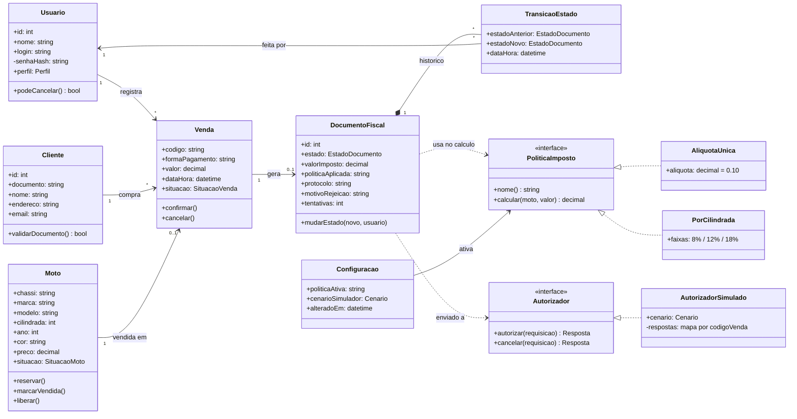

# Projeto Preliminar do EmiteJá

Visão geral, funcionalidades, classes, arquitetura preliminar e justificativas das decisões de projeto. Este documento parte do [Backlog do Produto](backlog-do-produto.md) e do [Documento de Requisitos](documento-de-requisitos.md).

**Equipe:** Abraão Gomes da Silva Araújo; Ednaldo Guilherme Lima Cordeiro; Kayk Thierry Araujo Silva

## 1. Visão Geral

O **EmiteJá** é um sistema web para revendas de motos que une a gestão de vendas à emissão do documento fiscal da venda. O cliente considerado é a Rota Motos (fictícia), que hoje controla o estoque em planilha e digita a nota em um programa separado, o que causa vendas duplicadas da mesma moto, notas repetidas, rejeições por erro de digitação e falta de visibilidade sobre a situação de cada nota.

No EmiteJá, a venda é a origem do documento: ao confirmar a venda de uma moto, o sistema gera o documento automaticamente, calcula o imposto pela política ativa, envia o documento a um autorizador por meio de um contrato de integração e acompanha cada estado do processamento. A mesma venda nunca gera dois documentos. O resultado da emissão volta para o estoque: documento autorizado deixa a moto Vendida; documento cancelado devolve a moto ao estoque.

Por ser um projeto acadêmico, a autorização é **simulada**: nenhum documento tem valor fiscal e nenhum serviço governamental é acessado. A política de cálculo de imposto é variável e explicitamente didática.

**Usuários:** Vendedor (vende e acompanha documentos), Gerente (mantém o estoque, cancela documentos e configura a política e o simulador) e Contador (consulta e exporta, somente leitura).

## 2. Funcionalidades

As 14 histórias do backlog foram agrupadas em seis módulos.

| Módulo | Funcionalidades | Histórias | Regras |
|---|---|---|---|
| Acesso | Login, perfis Vendedor, Gerente e Contador, bloqueio de funções por perfil | US01 | RN10, RNF05 |
| Estoque | Cadastro de motos, consulta com filtros, situação da moto (Disponível, Reservada, Vendida) | US02, US03 | RN03, RN04 |
| Clientes | Cadastro de clientes com CPF ou CNPJ validados, busca por nome ou documento | US04 | RN05 |
| Vendas | Registro e confirmação da venda, reserva da moto | US05 | RN03 |
| Emissão | Geração automática do documento, cálculo do imposto, envio ao autorizador, estados, bloqueio de duplicidade, correção e reenvio, reenvio automático, cancelamento | US06 a US09, US12 | RN01, RN02, RN06 a RN09 |
| Configuração e relatórios | Política de imposto ativa, cenário do simulador, painel mensal, exportação para o contador | US10, US11, US13, US14 | RN06, RN10 |

**Fluxo principal:** o vendedor consulta o estoque, seleciona a moto e o cliente e confirma a venda. A moto fica Reservada, o documento é criado em Rascunho, o imposto é calculado e o documento passa a Processando. Conforme a resposta do autorizador simulado, o documento termina Autorizado (moto Vendida), Rejeitado (vendedor corrige e reenvia) ou Pendente (reenvio automático).

## 3. Classes

O diagrama mostra as classes de domínio e as duas interfaces que tornam o sistema variável: a política de imposto e o autorizador.

**Enumerações:** `Perfil` (Vendedor, Gerente, Contador); `SituacaoMoto` (Disponível, Reservada, Vendida); `SituacaoVenda` (Confirmada, Cancelada); `EstadoDocumento` (Rascunho, Processando, Autorizado, Rejeitado, Pendente, Cancelado); `Cenario` (Sucesso, Rejeição, Indisponível).

| Classe | Responsabilidade | Regras |
|---|---|---|
| Usuario | Identifica quem opera o sistema e define o que cada perfil pode fazer. | RN08, RN10 |
| Moto | Guarda os dados do estoque e controla a própria situação. | RN03, RN04 |
| Cliente | Guarda o comprador e valida CPF ou CNPJ. | RN05 |
| Venda | Liga moto, cliente e vendedor; seu código é a chave de idempotência. | RN01, RN03 |
| DocumentoFiscal | Controla os estados da emissão e guarda imposto, política usada, protocolo e motivo de rejeição. | RN01, RN06, RN07 |
| TransicaoEstado | Registra cada mudança de estado, com data, hora e usuário. | RNF03 |
| PoliticaImposto | Contrato do cálculo; AliquotaUnica (variante A) e PorCilindrada (variante B) o implementam. | RN06 |
| Autorizador | Contrato de integração; AutorizadorSimulado responde sucesso, rejeição ou indisponível e repete a mesma resposta para a mesma venda. | RN02, RNF02 |
| Configuracao | Guarda a política ativa e o cenário do simulador escolhidos pela gerente. | US10, US11 |
